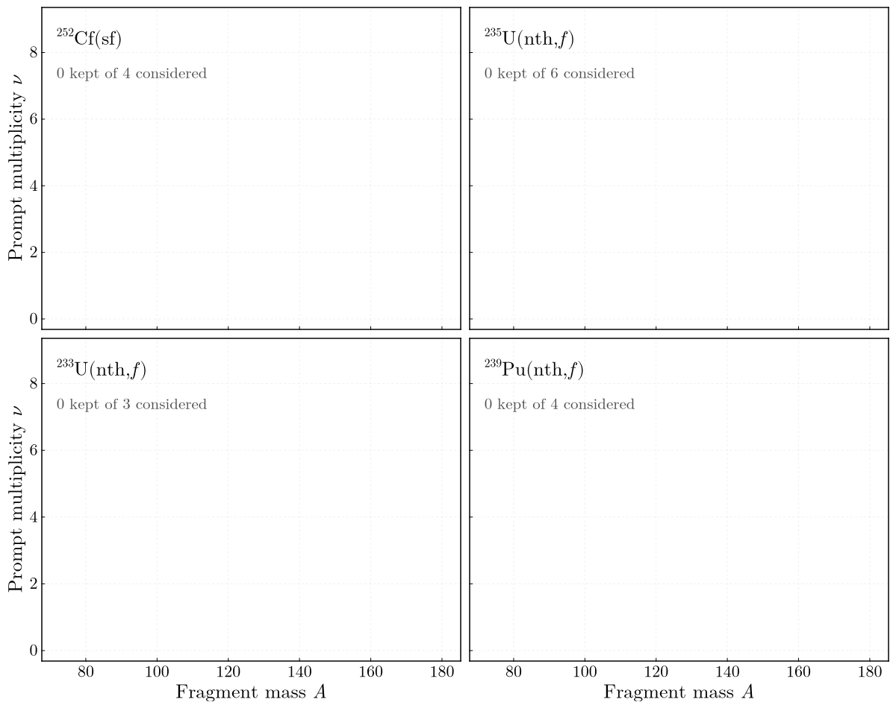

# ExforFissionData.jl

[](https://github.com/PaulGoG/ExforFissionData.jl/actions/workflows/CI.yml)
[](https://app.codecov.io/gh/PaulGoG/ExforFissionData.jl)
[](https://PaulGoG.github.io/ExforFissionData.jl/stable/)
[](https://PaulGoG.github.io/ExforFissionData.jl/dev/)
[](https://julialang.org)
[](https://github.com/JuliaTesting/Aqua.jl)
[](https://github.com/aviatesk/JET.jl)
[](https://github.com/domluna/JuliaFormatter.jl)
[](LICENSE)

Retrieval of experimental fission observables from the IAEA EXFOR archive, as tabulated data
files with a record of everything the query considered.

```
ExforFissionData.jl/
├── activate.jl        # silent activation of the package environment
├── check.jl           # pre-commit gate: format, then test
├── config/            # 86 retrieval configurations, <system>_<observable>.toml
├── scripts/
│   └── retrieve.jl    # entry point
├── src/               # the package: selection, reduction, export, run record
├── plotting/          # survey figures; an environment of its own
├── test/  docs/  formatter/
└── Project.toml  CHANGELOG.md  CITATION.cff  LICENSE
```

The full tree is [further down](#full-file-tree).

## Requirements

Julia 1.12 or later through [juliaup](https://github.com/JuliaLang/juliaup). Retrieval needs
network access to `nds.iaea.org`, since every run requests the listing of datasets; a run with
`offline = true` under `[retrieval]` needs none and works from the cache alone. The test suite
runs on Linux and macOS in CI.

## Installation

This is **not a registered package**: `Pkg.add("ExforFissionData")` will not find it. Either
clone it and work in the repository, as the configurations and scripts assume,

```bash
git clone https://github.com/PaulGoG/ExforFissionData.jl
cd ExforFissionData.jl
julia -e 'include("activate.jl")'
```

or add it to another environment by URL,

```julia
using Pkg
Pkg.add(url = "https://github.com/PaulGoG/ExforFissionData.jl")
```

Documentation: <https://PaulGoG.github.io/ExforFissionData.jl/stable/>

## Entry points

```bash
julia scripts/retrieve.jl config/Cf252_sf_nu_vs_A.toml             # retrieve one observable
julia scripts/retrieve.jl config/U233_nth_Y_vs_A.toml ~/data       # elsewhere
julia plotting/survey.jl data/Cf252_sf/nu_vs_A --format png        # figure to plots/Cf252_sf/nu_vs_A.png
julia plotting/coverage.jl data/{Cf252_sf,U235_nth,U233_nth,Pu239_nth}/nu_vs_A   # the animation
julia -e 'include("activate.jl"); Pkg.test()'                      # test suite
julia plotting/runtests.jl                                         # figure-helper tests
julia check.jl                                                     # format, then test
EXFORFISSIONDATA_TREE=~/data julia check.jl                        # also check a tree's tables
julia check.jl --check                                             # fail on formatting diffs
julia check.jl --docs                                              # also build the documentation
julia formatter/format.jl --check                                  # formatting check alone
julia docs/make.jl                                                 # build the documentation
julia -i activate.jl                                               # REPL in the environment
```

The package, `test/`, `docs/`, `formatter/` and `plotting/` each carry an `activate.jl` that
activates and instantiates the environment silently, so a fresh clone needs no preparation.
`test/` and `docs/` take the package by path, so they always run against the local source;
`plotting/` and `formatter/` do not depend on it. No invocation needs `--project`: every script
activates the environment it belongs to as its first statement.

```julia
using ExforFissionData
result = retrieve(load_configuration("config/Cf252_sf_nu_vs_A.toml"))
length(result.accepted), length(result.rejected)
```

## Status

| Component | State |
| :--- | :--- |
| Column contract, tag grammar, selection | tested; every abscissa and ordinate exercised against the live archive for 252-Cf(sf), 235-U(n,f), 233-U(n,f) and 239-Pu(n,f), and two observables for 240-Pu(sf). Reaction codes are compared code by code in their subfields |
| Curated readings, compilation defects, width columns | tested; every dataset read from its subentry text, every defect and every width conversion carries a test built from that subentry |
| Reduction: isomers, energy windows, other independent variables | tested on fixtures; the rejections checked against the live datasets that prompted them. The abscissa and the other variables are read from the subentry DATA table, aligned with the rendering row by row |
| Retrieval: cache, backoff, bounded concurrency | in use; result order independent of completion order, and the concurrency bound verified at limits 1 and 3 |
| Export and run record | in use; the pair sums recorded for ν(A) are formed again from the written tables by `test/written_tables.jl` whenever a retrieval tree is present |
| `plotting/survey.jl`, `plotting/coverage.jl` | in use; figures inspected |
| Static QA | Aqua, JET and ExplicitImports in the suite; formatting gated against a JuliaFormatter pinned in `formatter/Project.toml`; line coverage of `src/` from the Linux job on current stable, reported by Codecov |

The archive does not hold every pairing of abscissa and ordinate. Prompt multiplicity against
`["total_kinetic_energy"]` is reported as a pair quantity and needs `multiplicity_per_fission`.
252-Cf has no mass-resolved post-neutron kinetic energy. Of the four systems only 252-Cf has a
joint `Y(A, TKE)`, `23268002`; its code names no TKE and its csv rendering drops the TKE column,
so it is read from its subentry (see
[observables](https://PaulGoG.github.io/ExforFissionData.jl/stable/observables/#The-joint-yield-Y(A,-TKE))).
240-Pu, the compound nucleus of 239-Pu(n_th,f), has one of spontaneous fission in raw counts,
`22413013`.

## What it is for

A query names a fissioning system — target charge, target mass and entrance channel — and the
observable wanted as an abscissa and an ordinate. The package finds the datasets that answer it,
reduces each to one row per abscissa value, and writes them beside a run record naming every
dataset it kept or excluded, with the reason.

It is a data-preparation step: a consumer reads the files it writes and does not call it at run
time. The output is therefore plain whitespace-separated text with one header line, nothing is
normalised or filtered on the way out, and every exclusion is written down with its reason. Two
fission-model analyses of mine consume it in exactly that way, and where the documentation says
"consumers" it means those, or yours.



Prompt neutron multiplicity against fragment mass, one panel per fissioning system, as the
`*_nu_vs_A` configurations return it. Each frame advances through the datasets the archive offers
for that query in the order the pipeline processes them; a dataset enters the axes only where its
reaction code answers the query, and otherwise advances the tally alone. Of the 824 datasets
considered, 37 are kept; the rest are other quantities filed under the same target and reaction,
and the run record gives the reason each was left out.

## Configurations

A configuration is named for what it retrieves, `<system>_<observable>.toml`
(`config/U235_nth_TKE_vs_A.toml`, for instance), the same two tokens that name the directories
its data is written to.

| Observable | ²⁵²Cf(sf) | ²³⁵U(n,f) | ²³³U(n,f) | ²³⁹Pu(n,f) | ²⁴⁰Pu(sf) |
| :--- | :--- | :--- | :--- | :--- | :--- |
| Y(A), `Y_vs_A` | `Cf252_sf` | `U235_nth` | `U233_nth` | `Pu239_nth` | |
| ⟨TKE⟩(A), `TKE_vs_A` | `Cf252_sf` | `U235_nth` | `U233_nth` | `Pu239_nth` | |
| σ_TKE(A), `sigma_TKE_vs_A` | `Cf252_sf` | `U235_nth` | `U233_nth` | `Pu239_nth` | `Pu240_sf` |
| Y(A, TKE), `Y_vs_A_TKE` | `Cf252_sf` | `U235_nth` | `U233_nth` | `Pu239_nth` | `Pu240_sf` |
| Y(A_p), `Y_vs_A_p` | `Cf252_sf` | `U235_nth` | `U233_nth` | `Pu239_nth` | |
| Y(Z, A_p), `Y_vs_Z_A_p` | `Cf252_sf` | `U235_nth` | `U233_nth` | `Pu239_nth` | |
| E_K_p(A_p), `E_K_p_vs_A_p` | `Cf252_sf` | `U235_nth` | `U233_nth` | `Pu239_nth` | |
| ν(A), `nu_vs_A` | `Cf252_sf` | `U235_nth`, `U235_nres` | `U233_nth` | `Pu239_nth` | |
| ν(A, TKE), `nu_vs_A_TKE` | `Cf252_sf` | `U235_nth`, `U235_nres` | `U233_nth` | `Pu239_nth` | |
| ⟨ε⟩(A), `eps_vs_A` | `Cf252_sf` | `U235_nth`, `U235_nres` | `U233_nth` | `Pu239_nth` | |
| ⟨ε⟩(A, TKE), `eps_vs_A_TKE` | `Cf252_sf` | | `U233_nth` | | |
| T_eff(A), `T_eff_vs_A` | `Cf252_sf` | | | | |
| λ(A), `lambda_vs_A` | `Cf252_sf` | | | | |
| P(ν), `P_vs_nu` | `Cf252_sf` | `U235_nth` | `U233_nth` | `Pu239_nth` | |
| spectrum, `spectrum_vs_E` | `Cf252_sf` | `U235_nth` | `U233_nth` | `Pu239_nth` | |
| ratio to a Maxwellian, `spectrum_maxwellian_ratio_vs_E` | `Cf252_sf` | `U235_nth` | `U233_nth` | `Pu239_nth` | |
| ratio to 252-Cf(sf), `spectrum_cf252_ratio_vs_E` | | `U235_nth` | `U233_nth` | `Pu239_nth` | |
| M̄_γ, `M_gamma_bar` | `Cf252_sf` | `U235_nth` | `U233_nth` | `Pu239_nth` | |
| E_γ,tot, `E_gamma_tot` | `Cf252_sf` | `U235_nth` | `U233_nth` | `Pu239_nth` | |
| ε_γ, `eps_gamma` | `Cf252_sf` | `U235_nth` | `U233_nth` | `Pu239_nth` | |
| M_γ(A), `M_gamma_vs_A` | `Cf252_sf` | `U235_nth` | | | |
| M̄_γ(A), `M_gamma_bar_vs_A` | `Cf252_sf` | `U235_nth` | | | |
| ε_γ(A), `eps_gamma_vs_A` | | `U235_nth` | | | |
| E_γ(A), `E_gamma_vs_A` | `Cf252_sf` | | | | |
| E_γ,tot(A), `E_gamma_tot_vs_A` | `Cf252_sf` | | | | |
| M̄_γ(TKE), `M_gamma_bar_vs_TKE` | `Cf252_sf` | | | | |
| E_γ,tot(TKE), `E_gamma_tot_vs_TKE` | `Cf252_sf` | | | | |
| E_γ,tot(ν), `E_gamma_tot_vs_nu` | `Cf252_sf` | | | | |

The first four rows are what a pre-neutron Y(A, TKE) is built from: the mass yield, the mean TKE
and its width against mass, or the joint matrix. Each is retrieved measurement by measurement,
so that the marginals of one experiment can be taken together; the joint matrix exists for
252-Cf, and for 240-Pu(sf) in raw counts. Spontaneous fission of 240-Pu is fission of the
compound nucleus of 239-Pu(n_th,f) at about 6.5 MeV less excitation energy; its two
configurations stand in for 239-Pu(n_th,f), which has no joint matrix in the archive and a width
whose two columns disagree. The width has no EXFOR code, so its configurations name, dataset by
dataset, the column that holds it, what it holds and whose energy it is.

The three rows after Y(A, TKE) are the products after neutron emission: the post-neutron mass
yield, the independent yields of nuclides, and the kinetic energy of a product against its mass.
The post-neutron mass yield admits the chain yields of radiochemistry beside the yields of the
physical methods, since beta decay conserves A, and flags them in the record. The independent
yields are read from the `ELEMENT`, `MASS` and `ISOMER` headings of the subentry,
or from constants of its COMMON section, and a nuclide reported in several isomeric states is
written once, with what was done recorded per dataset. Fractional yields, yields of correlated
fragment pairs and partial yields at one product kinetic energy are refused. The archive holds no
mass-resolved post-neutron kinetic energy for 252-Cf, so `Cf252_sf_E_K_p_vs_A_p` writes nothing.

The last eleven rows are the prompt γ rays. The multiplicity, the total energy and the mean
photon energy per fission are written one value to a file. Against fragment mass the archive
holds values of one fragment and values per fission for 252-Cf and 235-U; against TKE and the
number of neutrons, for 252-Cf alone. A prompt-γ value is defined by the γ-energy range its
photons were counted over, the time window after fission and the corrections made, and these
move the total energy by up to about 1 MeV between experiments. Each record states them as the
entry or its publication does and names the datasets for which nobody states them. A set over a
partial or a limited range is written and flagged, not cut.

A system is an element symbol, a mass number and an **entrance channel**: `sf` spontaneous, `nth`
thermal-neutron-induced, `nres` resonance-region, `nfast` fast. The channel fixes the EXFOR
reaction code, so the configuration names only the channel. The incident-energy window,
`energy_min` and `energy_max`, defaults to the channel's interval (`nth` up to 0.1 eV, `nres`
0.1 eV to 100 keV, `nfast` 100 keV to 20 MeV) and may not leave it, so that a thermal directory
cannot hold a fast measurement. The physics behind the bounds is in
[the documentation](https://PaulGoG.github.io/ExforFissionData.jl/stable/channels/).

`U235_nres_nu_vs_A`, `U235_nres_nu_vs_A_TKE` and `U235_nres_eps_vs_A` span 0.1 eV to 1 keV for
the resonance-beam measurements, which a thermal window excludes on their incident energy; the
thermal datasets stay with the `nth` runs. `U235_nres` is a system of its own, so these land in
a directory of their own under the ordinary rule.

The mean centre-of-mass energy of the prompt neutrons of a fragment, ⟨ε⟩, is headed `DATA-CM`
rather than `DATA` in most subentries, and for this observable alone that column is read as the
datum. Its frame is read from that heading, from the text of the subentry or from the
publication the subentry cites, and recorded per dataset with the basis of the reading; each
record also says how the mean was formed. A dataset holding more than 5 MeV on any row is
refused: no mean neutron energy reaches that, and a fragment kinetic energy coded the same way
exceeds it by far.

`T_eff_vs_A` and `lambda_vs_A` hold the effective temperature and the exponent of the form
fitted to the centre-of-mass neutron spectrum of a fragment, which EXFOR keeps in `MISC` columns
of the mean neutron energy, so their configurations name the column dataset by dataset.

The multiplicity distribution P(ν) is coded with the branch `NUM` and tabulated in its subentry
against `PART-OUT`, the number of outgoing particles, which the csv rendering does not carry; the
rows of the two are aligned by order and the probabilities compared line by line. The mean of
each distribution is recorded against the ν̄ of the IAEA neutron data standards 2017, and a
distribution whose mean lies further than a quarter of ν̄ from it is refused as that of the
neutrons detected rather than emitted. An evaluation the archive holds under the same code is
written and flagged, not refused.

The `spectrum_maxwellian_ratio_vs_E` configurations retrieve the spectrum as a ratio to a
Maxwellian for 252-Cf(sf) and for thermal 235-U, 233-U and 239-Pu, coded with `MXD`, which the
plain spectrum excludes; each dataset must state the temperature of its Maxwellian, which the run
record gives. The `spectrum_cf252_ratio_vs_E` configurations retrieve the ratio of a system's
spectrum to that of 252-Cf(sf), the one observable read from a combination of two reaction codes,
written in whichever orientation the archive tabulates it.

Spectra are the one quantity the archive lists more of for 252-Cf than for 235-U, 156 datasets
against 125, the spontaneous-fission spectrum being a reference standard, and no incident-energy
window narrows the 252-Cf set.

Every configuration, key by key, is in [the documentation](https://PaulGoG.github.io/ExforFissionData.jl/stable/configurations/).

## Data ownership and archive load

The experimental data belongs to the [IAEA Nuclear Data Section](https://nds.iaea.org/exfor) and
to the groups that measured it. This package only automates queries against it; it neither
redistributes EXFOR data nor claims any rights over what it retrieves.

**Cite the original measurements.** Every retrieval writes the EXFOR accession number of each
dataset into the file name and the run record, so each measurement can be traced to its
publication.

EXFOR is a shared public service. Dataset responses are cached on disk, so a re-run costs the
archive one listing request. Leave that caching enabled and keep the configured concurrency
modest.

## How to cite

A result built on the data cites the measurements the run record names and the archive, whose
reference is in `CITATION.cff`. If the retrieval itself is referred to, cite the software:

```bibtex
@software{gogita2026exforfissiondata,
  author  = {Gogîță, Paul-Adrian},
  title   = {ExforFissionData.jl: retrieval of experimental fission observables from the IAEA EXFOR archive},
  version = {0.6.0},
  year    = {2026},
  url     = {https://github.com/PaulGoG/ExforFissionData.jl}
}
```

## What a retrieval writes

Retrieved data lands in `data/<system>/<observable>/` and is not version-controlled.

One directory per fissioning system, one subdirectory per observable, one file per measurement:

```
data/Cf252_sf/nu_vs_A/
├── retrieval.toml                        # the run record
├── 41425014_A.S.Vorobiev_2001.dat        # identifier, first author, year
├── relative/                             # arbitrary units; spectra and the joint yield only
└── subentries/
    └── 41425014_A.S.Vorobiev_2001.txt    # the original EXFOR subentry
```

Data files are space-separated with a single header line — `A nu nu_uncertainty`, or `A nu` where
the archive quotes no uncertainty. Where it quotes one on some rows only, the others hold `NaN`,
never zero:

```
A nu nu_uncertainty
81 0.644 0.06826
82 0.905 0.08244
```

Columns are named for the quantities they hold, an uncertainty as `<quantity>_uncertainty`, but a
reader takes them by **position**; see
[Naming](https://PaulGoG.github.io/ExforFissionData.jl/stable/naming/).

A retrieval never writes into an existing observable directory; it writes beside it, to
`<observable>_1`, then `_2`, and so on. To restage a tree, write to a fresh root or remove the old
observable directory first; see
[Retrieval](https://PaulGoG.github.io/ExforFissionData.jl/stable/retrieval/#Output-layout).

## Further reading

The reference lives in the documentation, one page per topic:

- [Observables](https://PaulGoG.github.io/ExforFissionData.jl/stable/observables/): the abscissae and ordinates, their quantity codes, the mean neutron energy and the spectrum ratios, the prompt γ rays and what defines each value, relative data, and what stays outside the observable set.
- [Entrance channels](https://PaulGoG.github.io/ExforFissionData.jl/stable/channels/): the incident-energy intervals and the physics behind them.
- [Conventions and selection](https://PaulGoG.github.io/ExforFissionData.jl/stable/conventions/): units, precision, one row per abscissa value, the selection checks, and the known miscoded entries.
- [Retrieval and the run record](https://PaulGoG.github.io/ExforFissionData.jl/stable/retrieval/): the cache, the archive dates, and every field of `retrieval.toml`.
- [Configurations](https://PaulGoG.github.io/ExforFissionData.jl/stable/configurations/) and [Naming](https://PaulGoG.github.io/ExforFissionData.jl/stable/naming/).

## Full file tree

<details>
<summary>Every tracked directory and file</summary>

```
ExforFissionData.jl/
├── activate.jl                  # silent activation of the package environment
├── check.jl                     # pre-commit: format with formatter/, then test
├── CHANGELOG.md
├── CITATION.cff
├── LICENSE
├── Project.toml
├── README.md
├── .JuliaFormatter.toml         # formatter settings shared by check.jl and CI
├── .gitignore
├── config/                      # 86 configurations, <system>_<observable>.toml
├── docs/                        # Documenter site
│   ├── activate.jl
│   ├── Project.toml
│   ├── make.jl
│   └── src/
│       ├── index.md
│       ├── observables.md       #   abscissae, ordinates, relative data
│       ├── channels.md          #   entrance channels and their incident-energy intervals
│       ├── conventions.md       #   conventions, selection, known miscoded entries
│       ├── retrieval.md         #   the cache, the run record, the output layout
│       ├── configurations.md    #   every shipped configuration, key by key
│       ├── naming.md            #   the naming convention, in full
│       ├── api.md               #   the exported names
│       ├── internals.md         #   the names that are not exported
│       └── assets/coverage.gif  #   the figure above, as plotting/coverage.jl writes it
├── formatter/                   # pinned JuliaFormatter environment
│   ├── activate.jl
│   ├── format.jl                #   the target list; `--check` names what differs
│   └── Project.toml             #   the pin, as an equality bound
├── plotting/                    # detached figures; not a dependency of retrieval
│   ├── activate.jl              #   silent activation of the plotting environment
│   ├── Project.toml
│   ├── style.jl                 #   theme, palette and labels shared by the scripts
│   ├── survey.jl                #   one figure per retrieval, as a check on what it returned
│   ├── coverage.jl              #   several retrievals accumulating, as an animation
│   └── runtests.jl              #   tests for the helpers in style.jl
├── scripts/
│   └── retrieve.jl              # entry point
├── src/
│   ├── ExforFissionData.jl      # module
│   ├── elements.jl              # chemical symbols, for naming a target by Z and A
│   ├── schema.jl                # the 39-column contract of the csv rendering
│   ├── subentry.jl              # the COMMON and DATA sections of a subentry
│   ├── reaction_codes.jl        # the tag grammar, as data
│   ├── curation.jl              # datasets read from their subentry text; defects; repeated runs
│   ├── widths.jl                # the width of the TKE distribution: columns, kinds, conversions
│   ├── gamma.jl                 # prompt γ: definitions, readings, refusals, stated values
│   ├── neutron_observables.jl   # fit parameters of the neutron spectrum; the moments of P(ν)
│   ├── client.jl                # retrieval: timeout, backoff, bounded concurrency, cache
│   ├── configuration.jl         # TOML loading and validation
│   ├── selection.jl             # what answers the query, and why the rest does not
│   ├── reduction.jl             # projection, isomers, duplicates
│   ├── results.jl               # what a retrieval returns
│   ├── export.jl                # data files and the run record
│   └── pipeline.jl              # orchestration
├── test/
│   ├── activate.jl
│   ├── Project.toml
│   ├── runtests.jl              # the preamble; includes the topic files below
│   ├── fixtures.jl              # synthetic responses in the layout of the csv rendering; helpers
│   ├── core_tests.jl            # column layout, value kinds, tag rules, repeats, isomers, reduction
│   ├── export_tests.jl          # file names, written tables, the run record
│   ├── configuration_tests.jl   # validation, the shipped configurations, Query, width columns
│   ├── client_tests.jl          # bounded concurrency, the response cache, a seeded retrieval
│   ├── kinetic_energy_tests.jl  # TKE against mass, curated readings, the width of the distribution
│   ├── yield_tests.jl           # pre-neutron masses, Y(A, TKE), independent yields, projections
│   ├── multiplicity_tests.jl    # blank uncertainties, PC/FIS, the complement test, P(ν)
│   ├── abscissa_tests.jl        # the subentry settles the abscissa
│   ├── subentry_tests.jl        # the subentry parser
│   ├── written_tables.jl        # a retrieval tree's tables against its records, when present
│   ├── gamma_tests.jl           # the prompt-γ observables
│   ├── limits_tests.jl          # bounds, approximate values, empty renderings
│   ├── neutron_energy_tests.jl  # the mean neutron energy of a fragment, its frame and formation
│   ├── spectrum_tests.jl        # spectra, the two ratios, the fitted-spectrum parameters
│   ├── curation_tests.jl        # correlation groups, preliminary and superseded datasets
│   └── quality_tests.jl         # Aqua, JET, ExplicitImports
└── .github/
    ├── dependabot.yml           # weekly updates for the julia and github-actions ecosystems
    └── workflows/
        ├── CI.yml               # tests, plotting suite, coverage to Codecov, documentation
        └── format.yml           # formatting check against the pinned JuliaFormatter
```

</details>
